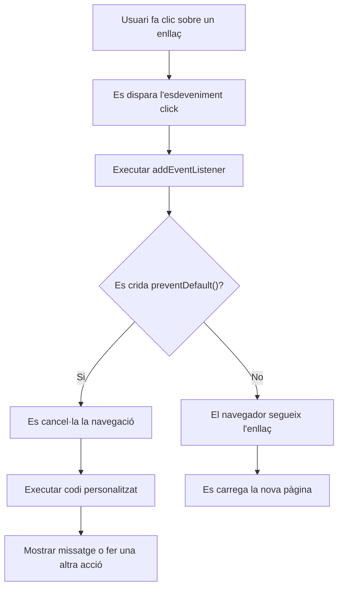
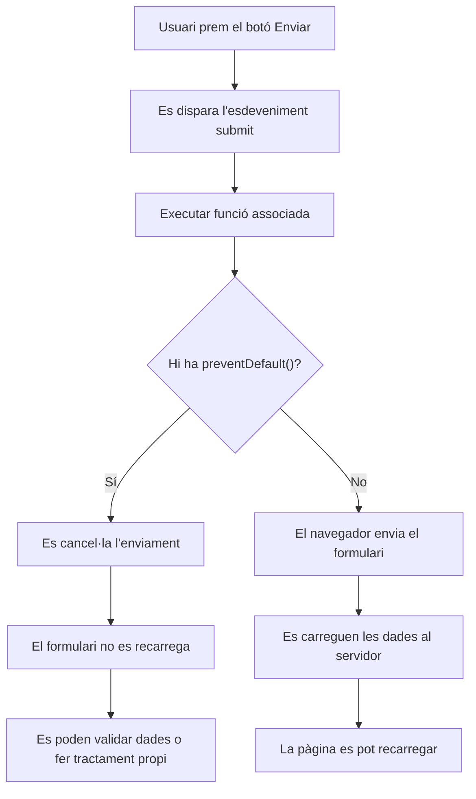
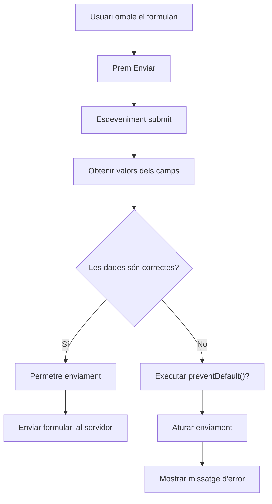
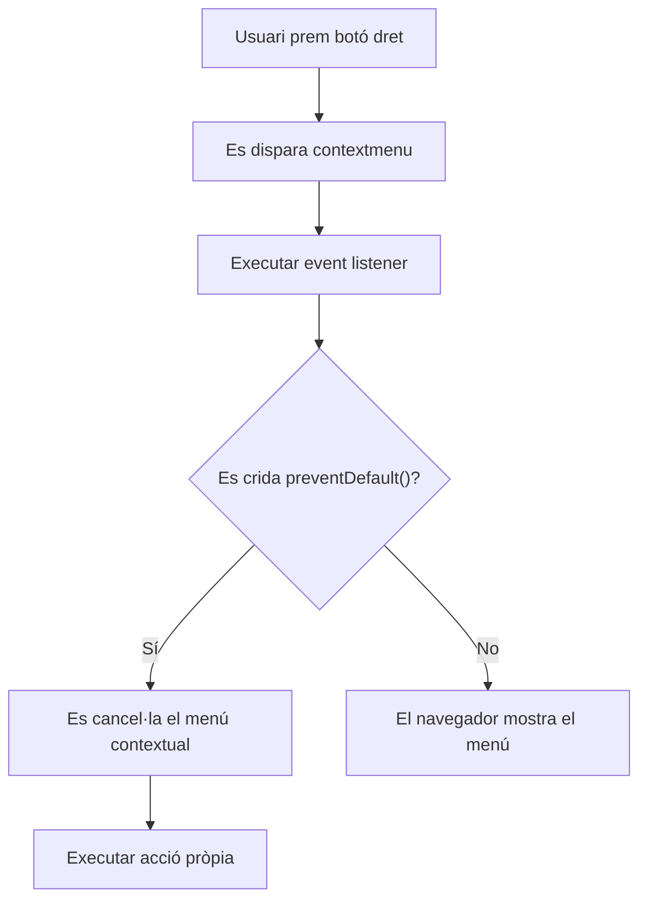
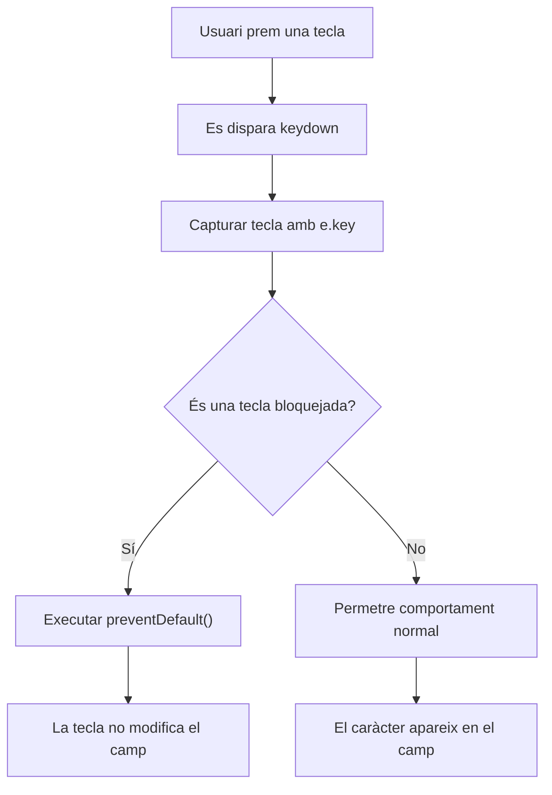
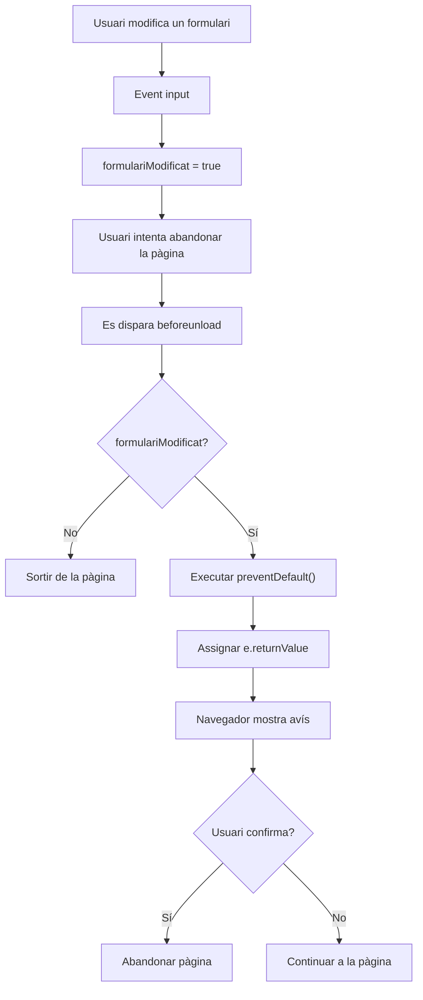

# Exemples d'ús de `preventDefault()`

`preventDefault()` és un mètode de l'objecte Event que serveix per evitar el comportament per defecte d'un element HTML.

Molts elements tenen una acció automàtica associada:

- Un enllaç `<a>` navega a una altra pàgina.
- Un formulari `<form>` envia les dades i recarrega la pàgina.
- Un botó dins d'un formulari pot enviar el formulari.
- El menú contextual apareix amb el botó dret.

Amb `preventDefault()` podem aturar aquest comportament i executar el nostre propi codi.

## Exemple 1: Evitar que un enllaç obri una pàgina

HTML

```html
<a href="https://www.google.com" id="enllac"> Anar a Google </a>
```

JavaScript

```JavaScript
const enllac = document.getElementById("enllac");

enllac.addEventListener("click", function(e) {

    e.preventDefault();

    alert("La navegació ha estat bloquejada");

});
```

Què passa?

Sense `preventDefault()`:



## Exemple 2: Evitar l'enviament d'un formulari

Aquest és un dels usos més habituals.

HTML

```html
<form id="formulari">
  <label>
    Nom:
    <input type="text" id="nom" />
  </label>

  <button type="submit">Enviar</button>
</form>
```

JavaScript

```JavaScript
const formulari = document.getElementById("formulari");

formulari.addEventListener("submit", function(e) {

    e.preventDefault();

    alert("No s'ha enviat el formulari");

});
```



## Exemple 3: Validar un formulari abans d'enviar-lo

HTML

```html
<form id="registre">
  <input type="text" id="usuari" />

  <button>Registrar-se</button>
</form>
```

JavaScript

```JavaScript
const registre = document.getElementById("registre");

registre.addEventListener("submit", function(e) {

    const usuari = document.getElementById("usuari").value;

    if (usuari === "") {

        e.preventDefault();

        alert("Has d'introduir un usuari");

    }

});
```

Aquí només bloquegem l'enviament si hi ha un error.



## Exemple 4: Evitar el menú contextual del botó dret

JavaScript

```JavaScript
document.addEventListener("contextmenu", function(e) {

    e.preventDefault();

    alert("Botó dret desactivat");

});
```



## Exemple 5: Evitar que una tecla faci una acció

Per exemple, impedir que s'escrigui una lletra concreta:

HTML

```html
<input type="text" id="camp" />
```

JavaScript

```javascript
const camp = document.getElementById("camp");

camp.addEventListener("keydown", function (e) {
  if (e.key === "a") {
    e.preventDefault();
  }
});
```

Ara la lletra a no s'escriurà al camp.



## Exemple 6: Evitar que un botó enviï un formulari

HTML:

```html
<form>
  <input type="text" />
  <button id="boto">Botó de prova</button>
</form>
```

Per defecte, un botó dins d'un formulari és de tipus `submit`.

JavaScript:

```JavaScript
document.getElementById("boto")
.addEventListener("click", function(e){

    e.preventDefault();

    alert("El botó no envia el formulari");

});
```



## Exemple 7: Evitar que es tanqui finestra per accident (beforeunload)

En aquest codi:

Javascript

```Javascript
window.addEventListener("beforeunload", function(e) {
    e.preventDefault();
    e.returnValue = "";
});
```

`preventDefault()` diu:

> "No continuïs amb l'acció automàtica d'abandonar la pàgina."

I:

```javascript
e.returnValue = "";
```

diu al navegador:

> "Demana confirmació a l'usuari abans de sortir."

## Resum ràpid

| Element             | Comportament per defecte Ús de `preventDefault()` |                      |
| ------------------- | ------------------------------------------------- | -------------------- |
| `<a>`               | Canvia de pàgina                                  | Evitar la navegació  |
| `<form>`            | Envia dades i recarrega                           | Fer validació pròpia |
| Botó dins formulari | Fa submit                                         | Evitar enviament     |
| Tecles              | Escriuen caràcters                                | Bloquejar tecles     |
| Botó dret           | Mostra menú                                       | Bloquejar menú       |
| `beforeunload`      | Abandona pàgina                                   | Demanar confirmació  |
